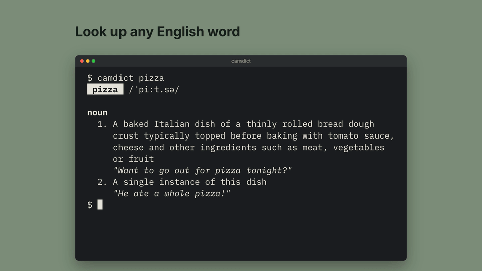
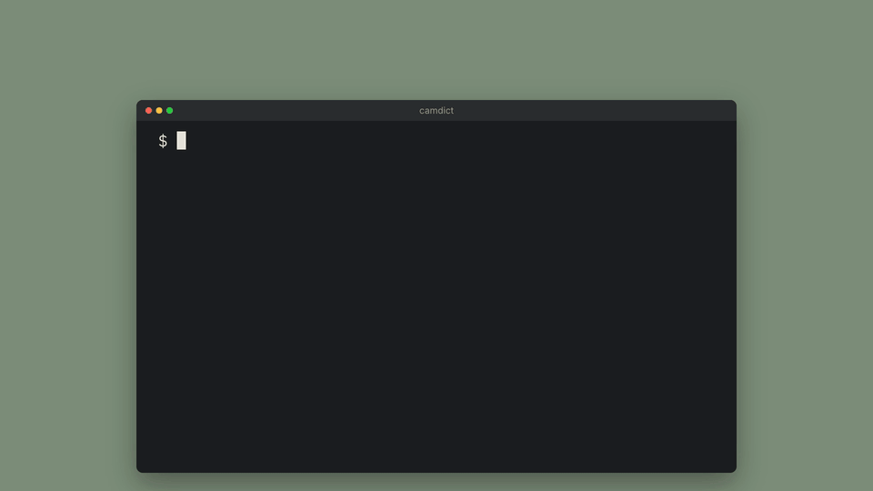
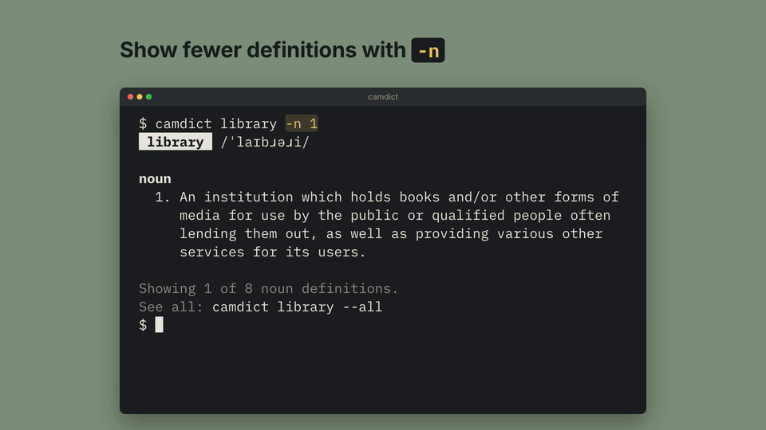

# Camdict

English dictionary in your terminal.

```
npm i -g camdict
```

Requires Node.js 22 or newer.

## Look up a word



```
camdict pizza
camdict "give up"
```

Put phrases in quotes. If a word is misspelled, camdict suggests the
closest matches.

## Hear the pronunciation



```
camdict wonderful -a
```

On macOS this needs no setup. On Linux or Windows, install `mpg123`, `ffmpeg`
or `mpv` first.

## Show more or fewer definitions



```
camdict library -n 1
camdict library --all
```

Camdict shows 3 definitions per part of speech unless you pass `-n` or
`--all`.

## Options

| Option | Alias | Description |
|---|---|---|
| `--audio` | `-a` | Play the pronunciation |
| `--limit` | `-n` | Definitions per part of speech (default 3) |
| `--all` | | Show every definition |
| `--no-color` | | Plain text, no styles (or set `NO_COLOR=1`) |
| `--help` | | Show usage |

Camdict exits with code 1 when the word is not found or the dictionary
service is unreachable.

## Data sources

Definitions come from the [Free Dictionary API](https://dictionaryapi.dev/),
pronunciations from [Wikimedia Commons](https://commons.wikimedia.org/) and
spelling suggestions from [Datamuse](https://www.datamuse.com/api/).
