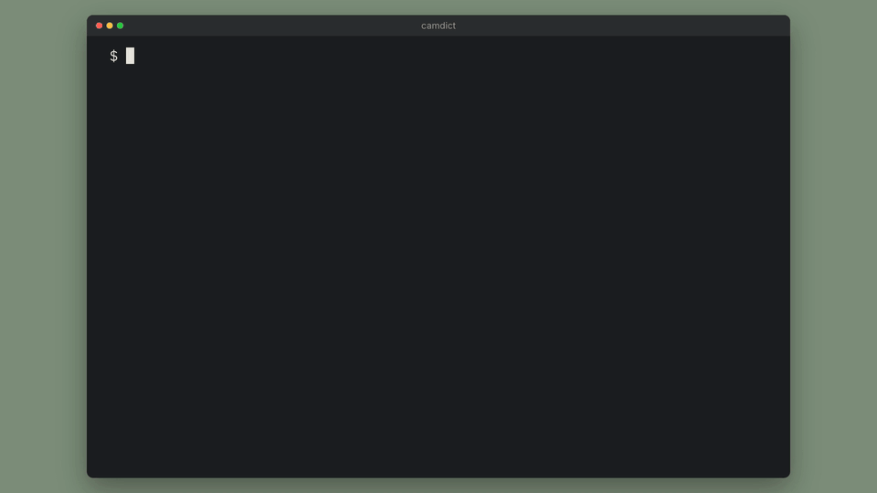

# Camdict

English dictionary in your terminal.



## Features

- Every meaning of the word, grouped by part of speech and numbered, with a
  usage example under each definition.
- The phonetic transcription next to the word.
- `--audio` plays the pronunciation. It picks the US recording when there is
  one.
- Text that stays legible on light and dark themes. Camdict styles it with
  bold, italic and dim instead of fixed colors, aligns wrapped lines under
  their definition, and honors `NO_COLOR`.
- Errors go to stderr with exit code 1, and camdict never wraps piped output,
  so it works in scripts.

```
$ camdict run -n 2
 run  /ɹʌn/

verb
  1. To run.
  2. To move swiftly.

noun
  1. Act or instance of running, of moving rapidly using the feet.
     "I just got back from my morning run."
  2. Act or instance of hurrying (to or from a place) (not necessarily
     by foot); dash or errand, trip.
     "I need to make a run to the store."

adjective
  1. In a liquid state; melted or molten.
     "Put some run butter on the vegetables."
  2. Cast in a mould.

Showing 2 of 35 verb · 2 of 23 noun · 2 of 5 adjective definitions.
See all: camdict run --all
```

## Installing

Requires Node.js 22 or newer.

```
npm i -g camdict
```

On macOS, `--audio` plays sound with the built-in `afplay`. On Linux or
Windows, install `mpg123`, `ffmpeg` or `mpv` first.

## Usage

```
camdict <word>            # camdict house
camdict "<phrase>"        # camdict "wrap up"
camdict <word> --audio    # also play the pronunciation (alias -a)
camdict <word> -n 10      # up to 10 definitions per part of speech (default 3)
camdict <word> --all      # every definition
camdict --help
```

| Option | Alias | Default | Description |
|---|---|---|---|
| `--audio` | `-a` | `false` | Play the pronunciation |
| `--limit` | `-n` | `3` | Maximum definitions shown per part of speech |
| `--all` | | `false` | Show every definition (overrides `--limit`) |
| `--no-color` | | | Disable colors and styles (same as `NO_COLOR=1`) |

When `--limit` cuts definitions, the last lines say how many it hid and print
the command that shows them all.

### Exit codes

| Code | Meaning |
|---|---|
| `0` | The word was found |
| `1` | The dictionary has no such word, no word was given, or camdict could not reach the dictionary service |

With `--audio`, a word that has no recording still exits with `0`. Camdict
shows the definitions and prints a warning.

## Data sources

Definitions come from the [Free Dictionary API](https://dictionaryapi.dev/).
Pronunciations come from [Wikimedia Commons](https://commons.wikimedia.org/),
because the API's own audio host no longer serves files.

Camdict used to scrape Cambridge Dictionary, which now blocks automated
requests with a Cloudflare challenge.
